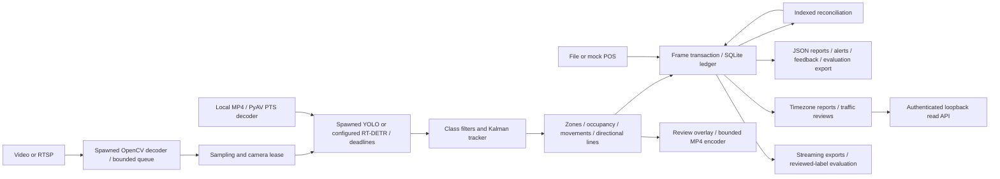

# Current architecture

Authoritative implemented architecture, reviewed 2026-11-12. Start with the
[project overview](../../README.md) and [implementation status](../../IMPLEMENTATION_STATUS.md).
Other architecture documents describe proposals unless explicitly identified as implemented here.

runtime.py owns process lifetime and leases; pipeline.py owns per-frame orchestration.
Detector and tracker protocols exist, but Pipeline currently selects KalmanTracker
directly. Zones depend on exact camera dimensions. Tables are calibrated geometry;
detecting a dining table is not required to rediscover static geometry every frame.

Record identifiers deduplicate the same source/run/camera/config replay. A new run
is an analytical session, not proof of new visitors. Overlapping camera runs require
explicit selection in business reports. Anonymous IDs do not persist across visits or cameras.
Failed frame transactions poison in-memory state; recovery replays from frame zero.
An authenticated, bounded loopback read API is implemented. Dashboard, preparation
classifier and handover classifier remain unimplemented.

Current paid quantities come from POS only. Visual placements/removals and unmatched
exits are separate observations/review candidates. The legacy report uses UTC/sample
weighting; business-report uses explicit IANA timezone/day boundaries and time-weighted
coverage. Traffic reviews append corrections; SQLite remains the source for aggregates.
New live runs store a source hash rather than credential-bearing URLs.
Historical records grow; the active decoder/tracker state
is bounded. See [audit](../audits/current_system_audit.md) for gaps and risks.

Stored event provenance joins the event's camera/run ID to the immutable run's
source identity, config hash, model metadata and start clock. Traffic records add
schema version, line ID, anchor evidence, interpolated crossing time and dwell
confirmation time. Processing timestamps belong to health/review records; injecting
new wall-clock values into a replayed immutable event would break idempotence.

The optional annotate-video orchestrator reuses detector deadlines, tracking, events
and frame transactions. Pickup presence/placement/departure and interaction
candidates are implemented when configured. Confirmed preparation, handover and
customer-role inference remain unavailable. Review exports stream to disk.

## Operational boundaries

The API binds only to 127.0.0.1. One shared bearer token authorizes the whole
read-only ledger, with at most eight request handlers, five-second socket timeouts
and one read-only SQLite connection per request. There are no accounts, sessions,
tenants, dashboard, uploads or payment-processing endpoints. `/healthz` is minimal
liveness; `/v1/health` requires authentication and reports storage readiness.
Status, events, cameras and business-report routes validate their query fields.
Pagination rejects values beyond SQLite's signed 64-bit range. API responses omit
evidence images, source URLs and filesystem paths; native process diagnostics can
still contain private paths and belong in protected local logs.

Each writer uses its own SQLite connection. Camera leases serialize writers for
the same camera; frame data and projections commit together. POS allocation is
transactional and quantity-bounded. Health and business history grow on disk and
need operator-owned backup, retention and capacity policies. In-memory queues,
tracker expiry, telemetry windows and review overlays are bounded. Output videos
and exports grow with clip length and need storage budgeting.

The CLI translates SIGTERM into interruption so existing `finally` blocks close
servers, stores and child processes. The production image runs as UID 10001,
contains runtime packages only, and disables automatic model/package downloads.
The Docker network and resource restrictions are invocation controls, not app
configuration. The default image command validates configuration and exits.
No provider deployment, public TLS endpoint or cloud egress policy exists.
