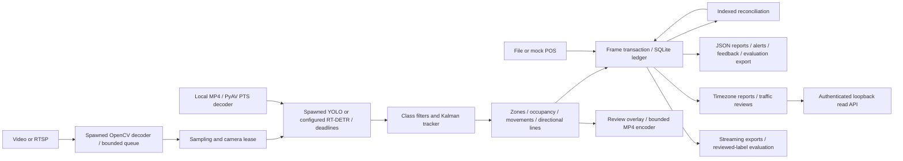

# Current architecture

runtime.py owns process lifetime and leases; pipeline.py owns per-frame orchestration.
Detector and tracker protocols exist, but Pipeline currently selects KalmanTracker
directly. Zones depend on exact camera dimensions. Tables are calibrated geometry;
detecting a dining table is not required to rediscover static geometry every frame.

Record identifiers deduplicate the same source/run/camera/config replay. A new run
is an analytical session, not proof of new visitors. Overlapping camera runs require
explicit selection in business reports. Anonymous IDs do not persist across visits or cameras.
Failed frame transactions poison in-memory state; recovery replays from frame zero.
An authenticated, bounded loopback read API is implemented. Dashboard, preparation
classifier and handover classifier remain unimplemented.

Current paid quantities come from POS only. Visual placements/removals and unmatched
exits are separate observations/review candidates. The legacy report uses UTC/sample
weighting; business-report uses explicit IANA timezone/day boundaries and time-weighted
coverage. Traffic reviews append corrections; SQLite remains the source for aggregates.
New live runs store a source hash rather than credential-bearing URLs.
Historical records grow; the active decoder/tracker state
is bounded. See [audit](../audits/current_system_audit.md) for gaps and risks.

Stored event provenance joins the event's camera/run ID to the immutable run's
source identity, config hash, model metadata and start clock. Traffic records add
schema version, line ID, anchor evidence, interpolated crossing time and dwell
confirmation time. Processing timestamps belong to health/review records; injecting
new wall-clock values into a replayed immutable event would break idempotence.

The optional annotate-video orchestrator reuses detector deadlines, tracking, events
and frame transactions. Pickup presence/placement/departure and interaction
candidates are implemented when configured. Confirmed preparation, handover and
customer-role inference remain unavailable. Review exports stream to disk.
