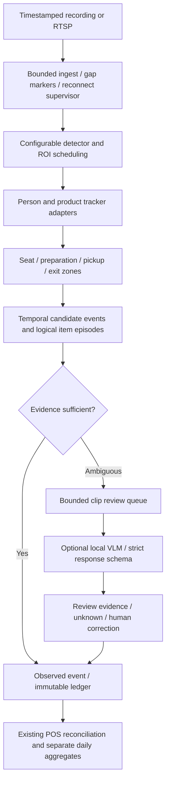

# Recommended architecture - pilot design

Status: recommendation, not an implemented or cafe-validated replacement. Retain
the modular monolith, immutable event/POS ledger and operational tests. Select a
detector after local latency and real-video accuracy evaluation. Static tables stay
calibrated polygons; use seat regions/person persistence for occupancy evidence.

The first pilot should compare the existing tracker against ByteTrack on exactly
the same recorded detections. Keep people/product association class-aware. Consider
BoT-SORT appearance features only when measured person fragmentation warrants their
extra inference and weight/privacy requirements. These alternatives are not currently
connected to Pipeline's tracker constructor.

Use a shared detector initially; split small-product counter crops from whole-frame
person detection only if recall-versus-cost measurements justify it. Cropping must
preserve full-frame coordinates and avoid duplicate overlapping-ROI tracks. Increase
product pixel resolution before assuming a larger model can recover invisible detail.

VLM review is optional and asynchronous. It sees a bounded, timestamped clip plus
candidate track/zone context, returns structured evidence and may abstain. Its queue
has a configured capacity and timeout; overflow becomes deferred/unknown review.
Neither text similarity nor an uncalibrated model confidence is a payment decision.
No VLM response supplies stable object IDs or writes authoritative counts directly.

On 6 GB VRAM, prove detector/VLM coexistence under worst-case visual tokens and KV
cache before loading both. A 2B model's parameter size alone is not a memory-fit
guarantee. Use measured queue rate and review service time to bound backlog; there
is no established camera capacity from current still-image probes.

Implementation order: annotated replay overlay, configurable tracker injection,
real-video detector/tracker comparison, logical item/event episodes, labeled action
rules, then optional VLM review only if it improves held-out event precision/recall.
After correctness, compare ONNX/OpenVINO on CPU and TensorRT/FP16 on this GPU, verifying
event parity. Reconnects, time-aware utilization and local business-day reporting are
separate correctness tasks; do not disguise them as detector improvements.
