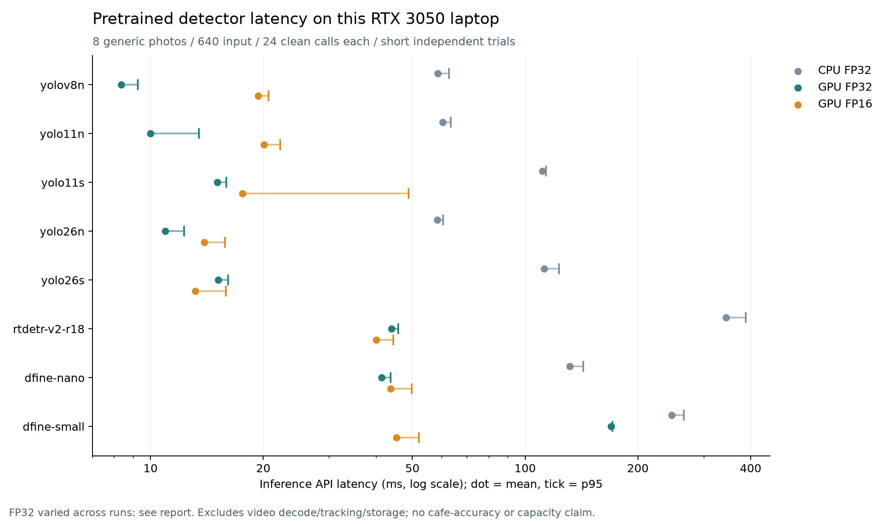

# Local performance report - 2026-11-07

Eight pretrained detectors were measured on this laptop in CPU FP32, CUDA FP32 and
CUDA FP16 modes. SmolVLM2-500M was also exercised on two still images. Larger VLMs,
optimized exports and cafe video accuracy were not measured.

## Environment and methodology

- Windows 11, Python 3.13.2, Intel i5-13450HX (10 cores / 16 logical processors),
  about 16 GB RAM; NVIDIA RTX 3050 6GB Laptop GPU, driver 610.60, 6,144 MiB VRAM.
- Isolated research environment: Ultralytics 8.4.204, Transformers 4.57.6. Detector
  CPU runs used Torch 2.9.0+cpu; CUDA runs used Torch 2.9.0+cu128 / TorchVision
  0.24.0+cu128. The VLM CPU probe used the CUDA build on device=cpu. Native CPU NMS
  and actual CUDA inference passed; operational .venv remains the separate CPU stack.
- Four Torch CPU threads, one interop thread, batch one, input 640x640, confidence
  0.25. YOLO uses square letterboxing; Transformers uses its native 640 resizing.
  Native preprocessing differences are included, so this compares adapters, not
  isolated FLOP counts or identical mathematical preprocessing. TF32 was disabled.
- First suite: three warmups, three passes over eight photos: 24 timed calls per
  condition/model. Clean, 35% brightness and Gaussian blur (9x9) conditions produce
  72 calls/model/mode. Transform construction is outside the timing interval.
- Timing includes preprocessing, device transfer, forward inference, native postprocess
  and conversion to shared boxes. CUDA synchronization brackets measurement. It excludes
  decode, multiprocessing IPC, tracking, SQLite, RTSP and capture-to-event delay.
- First warmup/load times and every timed call are saved. Download/load time is separate
  and can include cached downloads; the VLM probes include cold first generation.
- Process RSS is sampled every 20 ms while loading/running and can miss brief peaks.
  CUDA allocated/reserved peaks are Torch allocator statistics, not full device usage.
  GPU clocks/power mode/background desktop load were not fixed. These are short local
  engineering measurements, not sustained production or multi-camera capacity tests.

## Measured detector adapter latency

| Model | CPU FP32 mean / p95 ms | GPU FP32 mean / p95 ms | GPU FP16 mean / p95 ms | GPU FP16 serial images/s | Peak allocated GPU MiB |
|---|---:|---:|---:|---:|---:|
| yolov8n | 58.46 / 62.66 | 8.34 / 9.25 | 19.39 / 20.63 | 51.6 | 26.2 |
| yolo11n | 60.23 / 63.34 | 9.98 / 13.45 | 20.09 / 22.16 | 49.8 | 57.2 |
| yolo11s | 111.05 / 113.68 | 15.09 / 15.93 | 17.60 / 48.86 | 56.8 | 80.0 |
| yolo26n | 58.22 / 60.39 | 10.94 / 12.28 | 13.90 / 15.79 | 71.9 | 55.7 |
| yolo26s | 112.49 / 123.08 | 15.16 / 16.10 | 13.16 / 15.88 | 76.0 | 79.3 |
| rtdetr-v2-r18 | 343.73 / 388.10 | 44.03 / 45.87 | 40.00 / 44.53 | 25.0 | 96.4 |
| dfine-nano | 131.75 / 143.08 | 41.44 / 43.80 | 43.72 / 49.81 | 22.9 | 42.4 |
| dfine-small | 246.04 / 264.97 | 169.64 / 171.11 | 45.31 / 52.06 | 22.1 | 76.2 |

Images/s is 1000 / mean serial API latency, not full-system video FPS or camera
capacity. Do not compare these PyTorch numbers directly with vendor TensorRT timings.
The CPU nano models are close in this setup; YOLO26's published ONNX advantage was
not reproduced by this CPU-PyTorch comparison.

## Repeat check for the shortlist

YOLO11s had large initial FP16 latency spikes. A separate same-setting trial used
10 warmups and 10 passes per condition; the 80 clean calls below are not pooled with
or substituted into the first-suite table. All repeat/perturbed samples are retained.

| Model | Warmups | Timed clean images | Mean ms | p95 ms | Serial images/s |
|---|---:|---:|---:|---:|---:|
| yolo11s | 10 | 80 | 12.49 | 16.84 | 80.1 |
| yolo26s | 10 | 80 | 13.29 | 16.89 | 75.3 |
| rtdetr-v2-r18 | 10 | 80 | 36.20 | 40.78 | 27.6 |

YOLO11s and YOLO26s do not have a meaningful proven latency separation here. The
first-suite spikes remain evidence of variability; the repeat is not a production
p95 guarantee. RT-DETRv2 is slower in this adapter but remains a useful permissive
comparison. D-FINE was tested through the Transformers port, not its original
TensorRT implementation; these results do not establish an intrinsic architecture limit.

The table's FP32 GPU column uses a final all-model control sweep. Across earlier
trials, YOLO11s ranged from about 71 to 15 ms mean, RT-DETRv2 from about 205 to 44 ms,
and D-FINE-S from about 44 to 170 ms. The cause was not established: GPU clocks,
power/background activity and backend/cache behavior were not fully instrumented.
Do not attribute those differences to the catalog fix, or claim a dependable FP16
speedup from unpaired trials. FP16 shortlist repeats are the decision's primary
latency evidence; sustained controlled measurements remain necessary. Earlier
FP32 trial means/hashes and superseded catalog-run hashes are retained in run_index.

Transformer models were rerun after fixing six standard COCO label synonyms that
had initially been omitted by name-only mapping. The final adapter requires a
complete one-to-one catalog and fails on unexpected names. Only corrected diagnostic
results are included. A metadata-only CPU bootstrap reused the original verified
Torch CPU package for those reruns, preserving the CPU-build comparison.

## What the diagnostic accuracy means

[COCO8](https://docs.ultralytics.com/datasets/detect/coco8) contains eight COCO
training photos. This actual downloaded subset contains 30 annotated objects across
12 classes, including 10 people and **zero cups**. Training leakage is expected.
There are no tracks, preparation events, handovers or table occupancy labels.

The JSON includes precision/recall and the project's 101-point AP calculation to
verify adapter/scoring compatibility. Confidence is truncated at 0.25, the subset is
extremely small and leaky, and this is not official COCO evaluation. It cannot rank
cafe accuracy, cup recall or merchandise recognition. Brightness/blur sensitivity
is an artificial perturbation check, not a real low-light/occlusion benchmark.
FP16 also changed some detections; no accuracy-preservation clearance is implied.

## Small VLM probe: prompt sensitivity

Actual checkpoint: HuggingFaceTB/SmolVLM2-500M-Video-Instruct, exact revision in raw
results. Two original photos show a lunch box and giraffes; both were visually
inspected. Images were bounded to 512 pixels before the processor's own tiling.
Generation was greedy with at most 40 new tokens; latency includes preprocessing,
visual prefill and generation, with a cold first response. Output lengths differ.
Historical VLM JSON retains generic input_size=640/confidence=0.25 fields from the
detector CLI defaults; they were not used for VLM preprocessing or generation. Use
the 512-pixel thumbnail bound and canonical image_tensor_shape fields instead. The
reproducer now separates detector input size from VLM thumbnail metadata explicitly.

- CPU FP32 original prompt: 15.66 / 13.99 seconds.
- GPU FP16 original two-stage prompt API: 1.75 / 1.16 seconds.
- GPU FP16 canonical image-binding API, original prompt: 1.98 / 1.26 seconds.
- GPU FP16 canonical API, neutral prompt: 3.34 / 1.85 seconds.
- GPU probe peak allocated memory: 1352.4 MiB; memory fit was tested for this limited prompt/image workload only.

The original prompt asked for visible people and objects and allowed unknown. The
model incorrectly denied visible objects on both images, including with the canonical
API. The neutral prompt was: Describe this image in one sentence. It then described
food and giraffes. Thus missing image binding was not sufficient to explain the
failure; this probe demonstrates prompt-sensitive behavior in this setup. It does
not estimate overall VLM accuracy, video capability or a general hallucination rate.
Full prompts/responses, token counts and image-tensor shape for canonical probes are
retained. Some descriptive details still need human review.

This evidence supports keeping VLMs advisory. No Qwen3.5/MiniCPM-V/Qwen3-VL/InternVL/SmolVLM2-2.2B local
quality, latency, VRAM, video or commercial-deployment benchmark was performed.

## Reproduce

Install the verified application environment first. Create a separate research env
and reuse its scientific dependencies without replacing the application packages:
Use a fresh environment name if .venv-bench already exists; CPU-only measurements
are collected before installing CUDA overrides. The operational adapter's default
precision remains FP32; these standalone FP16 results are not deployed app throughput.

    .\.venv\Scripts\python.exe -m venv .venv-bench
    $verifiedSite = (Resolve-Path '.venv\Lib\site-packages').Path
    Set-Content '.venv-bench\Lib\site-packages\verified_base.pth' $verifiedSite -Encoding ASCII
    .\.venv-bench\Scripts\python.exe -m pip install -r requirements-benchmark.txt
    .\.venv-bench\Scripts\python.exe scripts/benchmark_suite.py --download --device cpu --output var/model-benchmark/cpu-new

For the historical CUDA measurements, the isolated benchmark environment used the
following matched wheels from the official PyTorch index. This is a reproduction
pin with known advisory debt, not a patched production recommendation:

    .\.venv-bench\Scripts\python.exe -m pip install --no-deps torch==2.9.0+cu128 torchvision==0.24.0+cu128 --index-url https://download.pytorch.org/whl/cu128
    .\.venv-bench\Scripts\python.exe scripts/benchmark_suite.py --download --device cuda:0 --precision fp32 --output var/model-benchmark/gpu32-new
    .\.venv-bench\Scripts\python.exe scripts/benchmark_suite.py --download --device cuda:0 --precision fp16 --output var/model-benchmark/gpu16-new
    .\.venv-bench\Scripts\python.exe scripts/benchmark_models.py --model yolo11s --download --device cuda:0 --precision fp16 --warmup 10 --repeats 10 --output var/model-benchmark/repeat-yolo11s-new.json

Repeat the last command for yolo26s and rtdetr-v2-r18. The suite's default model list
also runs the small VLM probe. Original VLM prompt comparison can be repeated with
--prompt "Describe the visible people and objects briefly. If uncertain, say unknown."
New script versions use the canonical image-binding API and default neutral prompt.

Omit --download and supply the recorded --revision to reuse cached HF models without
resolving moving revisions. YOLO checkpoints and dataset files carry SHA-256 hashes;
Transformers checkpoints are pinned to recorded repository commits. Loading uses
safetensors and disables remote code. CLI outputs refuse overwrite. Suite subprocess
failures/timeouts produce logs/status rather than fabricated measurements.

## Evidence and remaining gates

- [Raw results and hashes](results/run_index.json), [dataset coverage](results/data_manifest.json)
- [Publisher-verified large downloads](results/verified-downloads.json)
- [Research environment snapshot](benchmark-environment.txt)
- [Direct-package security lookup](../audits/dependency_advisories.json)
- [Current selection and next steps](model_validation_20261116.md), [real counting protocol](counting_evaluation.md)

No trained cafe model was produced or promoted. No model has verified coffee
preparation, handover, queue-wait or real table-occupancy accuracy here. Security-
patched runtime validation, full-process latency, live reconnects, sustained GPU load,
multi-camera contention and real-video labels remain deployment gates.
